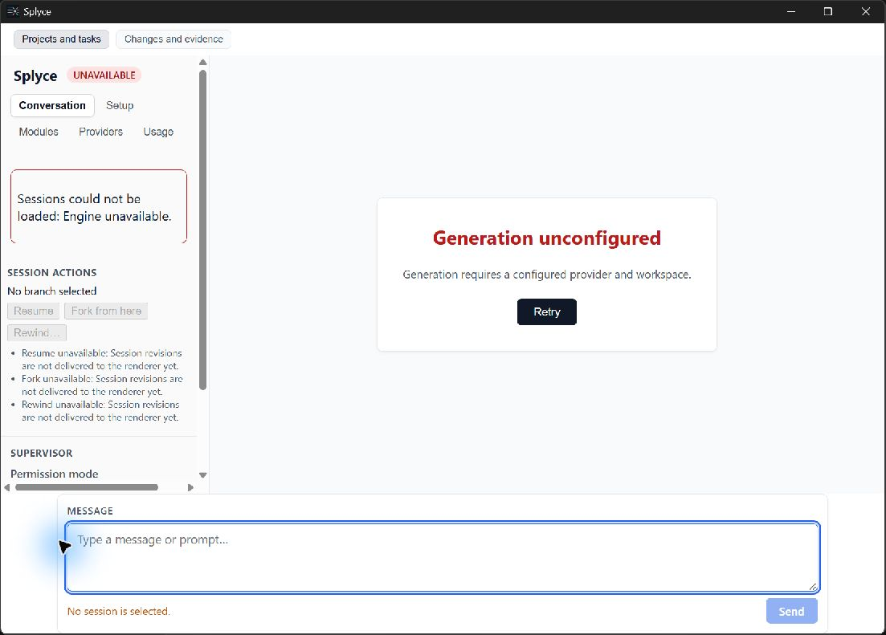

# M-159 native bootstrap protocol v1

Date: 2026-11-01. Tester: non-author Codex agent `pr174_native_manual_review`. Candidate source `f42295cda505246d9190f49533dfbe4ac025ea1c`; uninstrumented release executable SHA-256 `abf686ecbc6c02f9fd20e9d435783e24b74839b67f03ddfc3e3a3b12a5c65053`. Windows 11 25H2 build 26200.9711; WebView2 156.0.4314.58 as recorded in prior release smoke. CUA native input and Windows UIA tree. Default Windows profile, not an isolated or pristine fixture. Coordinator reported a hash-verified recovery snapshot of the existing app data before launch. No prompts, settings, session changes, generation, or engine termination were performed.

| Manual step and expected result                                                               | Observed                                                                                                                                                                                                                                                                                                                                                                                                                                    |
| --------------------------------------------------------------------------------------------- | ------------------------------------------------------------------------------------------------------------------------------------------------------------------------------------------------------------------------------------------------------------------------------------------------------------------------------------------------------------------------------------------------------------------------------------------- |
| M1 Launch uninstrumented app; inspect UIA names and disabled Send in Generation unconfigured. | Pass: read-only assertions against returned UIA text found heading Generation unconfigured, configured-provider/workspace explanation, form Composer, editable MESSAGE, status No session is selected, disabled Send and disabled Permission mode. UIA also exposed unavailable session actions with explanations.                                                                                                                          |
| M2 Tab and Shift+Tab show keyboard focus; inspect composer sizing and blocked explanation.    | Partial: at 1102×790, the composer and status were visible without clipping; Tab traversal reached the MESSAGE editor with a visible blue outline, and Shift+Tab returned to outlined Retry. UIA reported the containing pane rather than individual focused controls, so this is visual focus evidence, not an independent UIA focus assertion. Text-entry resizing and all changed controls were not exercised under the read-only scope. |
| M3 Observe actual owned engine loss and recovery state.                                       | Unperformed manually: the authorized observation excluded terminating an engine. The prior automated release smoke separately reports Engine stopped, disabled Send and cleanup; it is not a manual UIA observation.                                                                                                                                                                                                                        |

Screenshot alone does not establish accessibility or execution denial. The prior automated receipt `apps/desktop/src-tauri/target/bootstrap-smoke/2026-11-01T16-21-09.158Z/result.json` records native denial and both unconfigured and disconnected states for this executable. Its runner confirmed it inherited the default profile; it does not prove pristine-profile behavior. The owned app window was closed after observation.

Applicable scope is bootstrap Composer sizing/status/focus, generation-unconfigured explanation and engine-loss recovery, not the full V1 matrix. Narrator speech, real IME, system contrast/reduced motion, text scaling, mixed DPI, complete keyboard coverage, actual UIA focus assertions and before screenshots remain unperformed. No installed-app or full V1 qualification is claimed.
