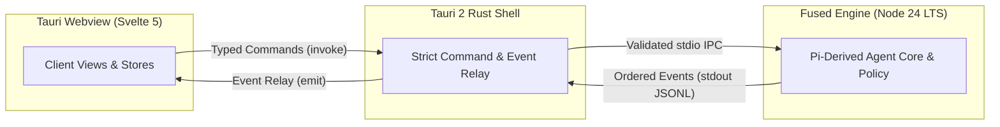
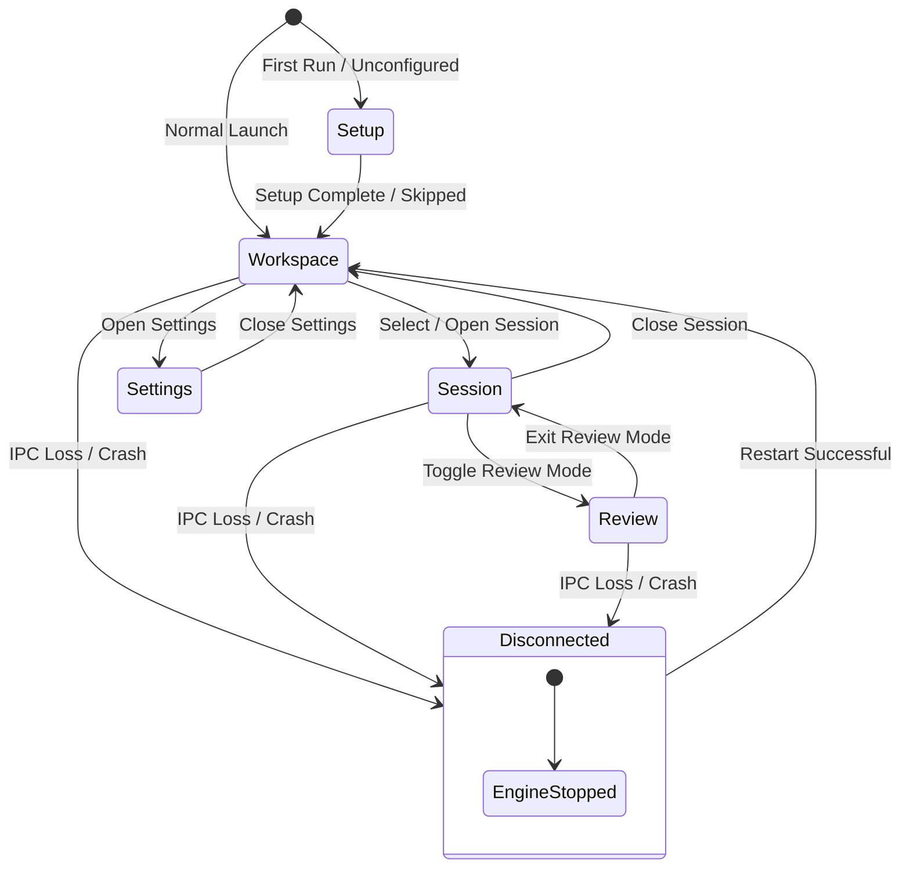
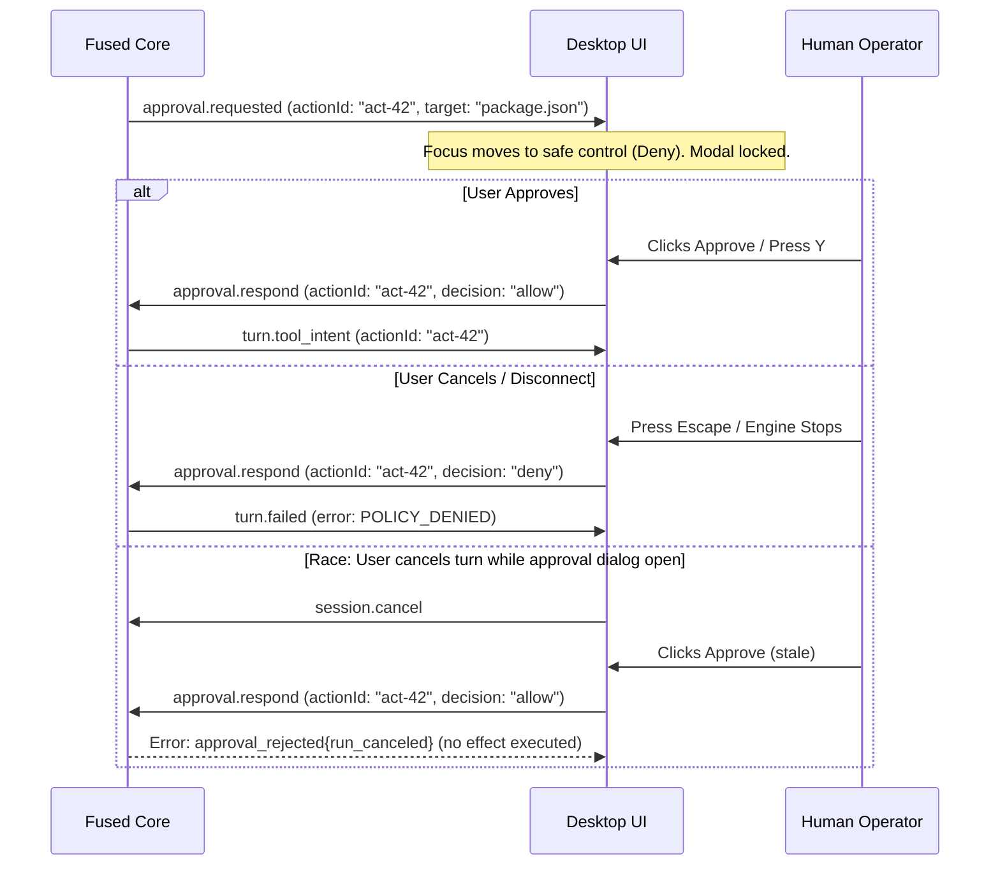

# Desktop client contract

**Status:** Proposed specification for TD-02 (`client-contract.md`), authored by **`MdSiddiqx`** (UI/UX Lead) to unblock TD-01 shared contract freezing. Reconciled **2026-10-26** with the [desktop application contract](desktop-application.md), [frontend dossier](../frontend/README.md), and [team delivery plan](team-delivery-plan.md).

This contract specifies the typed interface between the **Windows Tauri 2 / Svelte 5 desktop GUI** and the **Splyce-owned fused Pi core engine**. It defines window and screen lifecycles, typed IPC command and event schemas, approval resolution mechanics, the semantic design token sheet, and the keyboard shortcut catalog.

---

## 1. Architectural principles and boundaries

1. **One authority path:** The fused TypeScript engine running on Node 24 LTS is the sole operational authority. The Svelte renderer and Tauri Rust supervisor do not maintain competing agent loops, parallel stores, or independent command dispatchers.
2. **No terminal embedding:** Splyce V1 is a dedicated Windows desktop GUI workbench. It does not embed an xterm/terminal emulator into a window to simulate a desktop product. All interactions use accessible, semantic controls and structured message feeds.
3. **Explicit requested vs. effective state:** The UI clearly distinguishes between what the user has requested (e.g. pending model switch, prompt submission, approval response) and what the engine has confirmed as effective state.
4. **Resilient to engine disconnect:** If the engine process crashes, exits, or loses IPC connectivity, the client freezes inputs, retains drafts and recent logs, shows an explicit **Engine stopped** banner, and provides a single explicit **Restart Engine** action. Stale approval dialogs are neutralized immediately.



---

## 2. Window and screen states

### 2.1 Window lifecycle states

The desktop application manages five distinct window display modes:

| Window mode | Description                                                             | Behavior & accessibility constraints                                                                                                         |
| :---------- | :---------------------------------------------------------------------- | :------------------------------------------------------------------------------------------------------------------------------------------- |
| `normal`    | Standard windowed mode with custom titlebar and native window controls. | Respects minimum window dimensions (800x600 px). Preserves custom layout widths across restarts.                                             |
| `maximized` | Maximized on current active display.                                    | Expands to display working area; padding/margins adapt to high-DPI scaling.                                                                  |
| `minimized` | Window minimized to taskbar.                                            | Throttle rendering updates to save CPU/GPU; do not drop or buffer-overflow incoming engine events.                                           |
| `inactive`  | Window lost OS focus (background application).                          | Subdue selection indicators; maintain readable contrast; do not auto-dismiss modal approval requests.                                        |
| `high_dpi`  | Display scaling at 125%, 150%, 175%, or 200%.                           | All layout dimensions, borders, and fonts scale proportionally using CSS custom properties (`rem` / `px`). No blurred text or icon clipping. |

### 2.2 Screen state machine

The renderer operates across six defined top-level screens:



1. **`Setup` (First-run):** Minimal onboarding for new workspaces. Allows selecting base-only barebones mode or configuring local/cloud provider profiles. Never forces automatic external model downloads.
2. **`Workspace` (Project rail):** Project selector, workspace tree, active worktree indicator, and open session list.
3. **`Session` (Conversation workbench):** Primary task view:
   - Left: Session/branch tree and turn anchors.
   - Center: Structured chronological transcript (Markdown text, tool intent/outcomes, collapsible thought deltas).
   - Bottom: Composer textarea with IME composition guards, context chips, and submit affordance.
   - Right: Collapsible contextual changes/evidence pane.
4. **`Review` (Hunk review & diff):** Accessible unified or side-by-side diff viewer for pending workspace modifications. Provides per-hunk inspection, accept/revert triggers, and file status badges.
5. **`Settings` (Configuration & profiles):** Granular controls for model roles (generation, extraction, embedding), API credentials, MCP servers, and file lease policies.
6. **`Disconnected` (Engine failure):** Safety modal overlay when the background engine is dead. Displays the exact exit code or redaction-safe reason, preserves current composer text, and offers an explicit **Restart Engine** button.

---

## 3. Typed IPC command schema (Renderer $\rightarrow$ Engine)

All commands sent from the Svelte client pass through Tauri's validated command boundary using a strict command allowlist:

- `invoke("handshake", { protocolVersion: number })`
- `invoke("send", { op: string, payload: unknown })`
- `invoke("cancel", { sessionId: string, reason?: string })`
- `invoke("subscribe", { sessionId: string, afterSeq?: number })`
- `invoke("dialog_select_workspace", {})` (returns a scoped grant token, not raw renderer path authority)

```typescript
export type SplyceCommand =
  | { op: "session.start"; payload: SessionStartPayload }
  | { op: "session.prompt"; payload: SessionPromptPayload }
  | { op: "session.steer"; payload: SessionSteerPayload }
  | { op: "session.fork"; payload: SessionForkPayload }
  | { op: "approval.respond"; payload: ApprovalResponsePayload }
  | { op: "workspace.select"; payload: WorkspaceSelectPayload }
  | { op: "config.set_profile"; payload: SetProfilePayload }
  | { op: "lease.acquire"; payload: LeaseAcquirePayload }
  | { op: "lease.release"; payload: LeaseReleasePayload }
  | { op: "engine.restart"; payload: Record<string, never> };

export interface SessionStartPayload {
  workspaceRef: string; // Scoped native dialog grant token
  piSessionId?: string;
  initialPrompt?: string;
  profileId: string;
}

export interface SessionPromptPayload {
  sessionId: string;
  text: string;
  contextArtifactIds?: string[];
  effortBinding?: "low" | "medium" | "high" | "max";
}

export interface SessionSteerPayload {
  sessionId: string;
  actionId: string;
  instruction: string;
}

export interface SessionForkPayload {
  sourceSessionId: string;
  forkFromEntryId: string;
  newBranchName?: string;
}

export interface ApprovalResponsePayload {
  requestId: string; // Single-use unique approval request token
  runId: string;
  actionId: string;
  revisionHash: string; // Bound revision hash preventing stale grant expansion
  decision: "allow" | "deny";
}

export interface WorkspaceSelectPayload {
  workspaceRef: string; // Scoped native dialog folder token, not arbitrary renderer path
  displayName: string;
}

export interface SetProfilePayload {
  profileId: string;
  overrides?: Record<string, string>;
}

export interface LeaseAcquirePayload {
  paths: string[];
  ttlSeconds: number;
  reason: string;
}

export interface LeaseReleasePayload {
  paths: string[];
}
```

---

## 4. Typed engine event schema (Engine $\rightarrow$ Renderer)

The engine streams ordered, sequence-numbered events to the client. The client tracks the monotonic event sequence number (`seq`), deduplicates replays via `eventId`, and distinguishes durable records from coalescible transient deltas via `durability`.

```typescript
export interface SplyceEventEnvelope {
  seq: number;
  eventId: string; // Monotonic UUIDv7 or stable ID for deduplication
  ts: number; // Unix timestamp in ms
  sessionId: string;
  durability: "durable" | "transient"; // Durable: guaranteed across reconnects; Transient: coalescible display deltas
  cursor?: number; // Monotonic durable sequence acknowledged by client
  event: SplyceEngineEvent;
}

export type SplyceEngineEvent =
  | { kind: "turn.started"; runId: string; turnId: string }
  | { kind: "turn.stream_delta"; runId: string; turnId?: string; delta: string }
  | {
      kind: "turn.thought_delta";
      runId: string;
      turnId?: string;
      delta: string;
    }
  | {
      kind: "turn.tool_intent";
      runId: string;
      actionId: string;
      capabilityId: string;
      target: string;
      argsSummary: string;
    }
  | {
      kind: "turn.tool_outcome";
      runId: string;
      actionId: string;
      status: "success" | "error" | "uncertain";
      outcomeRef?: string;
      error?: string;
      /** Optional and strict: unknown keys, a preview over 2048 chars, negative or non-integer numbers are rejected. `bytes` is the raw output size; `preview` is already redacted. */
      summary?: {
        exitCode?: number | null;
        durationMs?: number;
        bytes?: number;
        truncated?: boolean;
        preview?: string;
      };
    }
  | {
      kind: "turn.completed";
      runId: string;
      candidateSnapshotId: string;
      finalRevision: string;
    }
  | { kind: "turn.failed"; runId: string; error: SplyceErrorPayload }
  | { kind: "turn.canceled"; runId: string; cleanedUp: boolean }
  | {
      kind: "approval.requested";
      runId?: string;
      actionId: string;
      capabilityId: string;
      targetScope: string;
      normalizedTarget: string;
      riskRationale: string;
      timeoutMs?: number;
    }
  | {
      kind: "run.reconnect_snapshot";
      runId: string;
      lastDurableSeq: number;
      turnId?: string;
      activeActionIds: string[];
      state: "ready" | "busy" | "waiting_approval" | "stopped";
    }
  | {
      kind: "session.tree_updated";
      sessionId: string;
      branchAnchorId: string;
      leaves: string[];
    }
  | {
      kind: "engine.status";
      state: "ready" | "busy" | "stopping" | "stopped";
      activeWorkers: number;
    };

export interface SplyceErrorPayload {
  code:
    | "POLICY_DENIED"
    | "UNSUPPORTED_PROVIDER"
    | "ENGINE_CRASH"
    | "UNCERTAIN_EFFECT"
    | "STALE_REVISION"
    | "TIMEOUT";
  message: string;
  correlationId: string;
  retryable: boolean;
  suggestedAction?:
    "RESTART_ENGINE" | "SWITCH_PROFILE" | "REVERT_HUNK" | "RETRY_SAFE";
}
```

---

## 5. Approval mechanics and race-condition resolution

Approval requests occur when a tool or operation requires explicit human-in-the-loop authorization (e.g. destructive workspace changes, process execution, credential usage).



### Invariants

1. **Initial focus:** When an approval dialog appears, focus moves immediately to a non-destructive control (**Deny** or **Inspect Details**), never to the Approve button.
2. **Keyboard safety:** `Escape` immediately denies or dismisses the approval. `Enter` does not trigger approval unless the Approve button has been explicitly tabbed to and focused.
3. **Linearized resolution:** Approvals and cancellations linearize at the engine. A late approval sent after a turn cancellation returns `approval_rejected{run_canceled}` with zero executed side effects.
4. **Scope immutability:** If the file target, git branch, or underlying revision changes while the dialog is visible, the approval is invalidated automatically.

---

## 6. Semantic design token sheet (TD-75 specification)

Splyce employs a unified semantic token architecture based on CSS custom properties. Raw hex values are restricted to foundational palettes; components consume semantic aliases exclusively.

```css
:root {
  /* Surface hierarchy */
  --splyce-surface-base: #0f1115; /* Main canvas background */
  --splyce-surface-subtle: #161920; /* Navigation rail & sidebars */
  --splyce-surface-raised: #1e222b; /* Cards, dialogs, composer */
  --splyce-surface-overlay: #282d39; /* Dropdowns, tooltips, flyouts */

  /* Text & Foreground */
  --splyce-text-primary: #f0f3f8; /* High-contrast body & headings */
  --splyce-text-secondary: #9da7b8; /* Metadata, labels, inactive tabs */
  --splyce-text-muted: #647087; /* Placeholders, disabled markers */
  --splyce-text-inverse: #0f1115; /* Text on accent badges */

  /* Border & Dividers */
  --splyce-border-subtle: #232732; /* Panes & subtle dividers */
  --splyce-border-default: #323847; /* Card outlines, input fields */
  --splyce-border-strong: #4f586e; /* Focused frames, active items */

  /* Focus & Selection */
  --splyce-focus-ring: #4f8cff; /* 2px solid accessible focus ring */
  --splyce-focus-offset: 2px;
  --splyce-selection-bg: #264478; /* Highlighted text background */
  --splyce-selection-fg: #ffffff;

  /* State & Sentiment */
  --splyce-status-success: #2ecc71; /* Completed steps, verified green */
  --splyce-status-warning: #f39c12; /* Leases, uncertain effects */
  --splyce-status-danger: #e74c3c; /* Failed runs, denied policies */
  --splyce-status-info: #3498db; /* Model notices, status chips */
  --splyce-status-pending: #8e44ad; /* Active tool execution */

  /* Typography Scale */
  --splyce-font-family-ui:
    -apple-system, BlinkMacSystemFont, "Segoe UI Variable Text", "Segoe UI",
    system-ui, sans-serif;
  --splyce-font-family-mono: "Cascadia Code", "Consolas", monospace;
  --splyce-font-size-xs: 0.75rem; /* 12px - timestamps & badges */
  --splyce-font-size-sm: 0.875rem; /* 14px - secondary text & UI labels */
  --splyce-font-size-base: 1rem; /* 16px - conversation body text */
  --splyce-font-size-lg: 1.25rem; /* 20px - pane headings */
  --splyce-font-size-xl: 1.5rem; /* 24px - modal titles */
  --splyce-line-height-normal: 1.5;
  --splyce-line-height-mono: 1.4;

  /* Spacing Scale */
  --splyce-space-1: 0.25rem; /* 4px */
  --splyce-space-2: 0.5rem; /* 8px */
  --splyce-space-3: 0.75rem; /* 12px */
  --splyce-space-4: 1rem; /* 16px */
  --splyce-space-6: 1.5rem; /* 24px */
  --splyce-space-8: 2rem; /* 32px */

  /* Motion & Transitions */
  --splyce-transition-fast: 120ms cubic-bezier(0, 0, 0.2, 1);
  --splyce-transition-normal: 200ms cubic-bezier(0, 0, 0.2, 1);
}

/* Reduced motion preference */
@media (prefers-reduced-motion: reduce) {
  :root {
    --splyce-transition-fast: 0ms !important;
    --splyce-transition-normal: 0ms !important;
  }
}

/* Windows High Contrast / Forced Colors Mode */
@media (forced-colors: active) {
  :root {
    --splyce-surface-base: Canvas;
    --splyce-text-primary: CanvasText;
    --splyce-border-default: ButtonBorder;
    --splyce-focus-ring: Highlight;
    --splyce-selection-bg: Highlight;
    --splyce-selection-fg: HighlightText;
  }
}
```

---

## 7. Keyboard shortcut catalog (TD-73 / TD-77 specification)

Every visual action provides an explicit, accessible keyboard shortcut. Shortcut bindings avoid intercepting standard Windows text editing keys (`Ctrl+A`, `Ctrl+C`, `Ctrl+V`, `Ctrl+Z`, `AltGr`).

| Category          | Shortcut       | Command / Action                           | UI Indicator / Affordance     |
| :---------------- | :------------- | :----------------------------------------- | :---------------------------- |
| **Landmarks**     | `Ctrl+1`       | Focus Project & Workspace Rail             | Rail landmark outline         |
|                   | `Ctrl+2`       | Focus Session / Transcript View            | Transcript container focus    |
|                   | `Ctrl+3`       | Focus Changes & Review Pane                | Review pane tab highlight     |
|                   | `Ctrl+4`       | Focus Settings / Profile Selector          | Settings gear dialog          |
| **Composer**      | `Ctrl+Enter`   | Submit current prompt (outside active IME) | Primary "Send" button tooltip |
|                   | `Enter`        | Insert newline in prompt textarea          | Standard editing behavior     |
|                   | `Escape`       | Cancel active draft / unfocus composer     | Restores focus to transcript  |
| **Execution**     | `Ctrl+K`       | Open Scoped Command Palette                | Centered modal palette        |
|                   | `Ctrl+C`       | Interrupt active generation / cancel turn  | Cancel button in composer     |
| **Review / Diff** | `J`            | Navigate to next diff hunk                 | Active hunk frame highlight   |
|                   | `K`            | Navigate to previous diff hunk             | Active hunk frame highlight   |
|                   | `A`            | Accept / stage selected hunk               | Staged check badge            |
|                   | `D`            | Revert / discard selected hunk             | Discard confirmation popover  |
|                   | `Space`        | Toggle review pane collapse                | Chevron rotation              |
| **Approvals**     | `Y`            | Approve action (only when modal focused)   | Approve button outline        |
|                   | `N` / `Escape` | Deny action / dismiss modal safely         | Deny button outline           |

### IME Safeguard Invariant

When an Input Method Editor (IME) is active (e.g., Japanese, Chinese, Korean candidate conversion where `event.isComposing === true`), `Enter` confirms the character candidate and **never** triggers prompt submission.

---

[Frontend index](../frontend/README.md) · [Delivery plan](team-delivery-plan.md) · [Design index](README.md)
