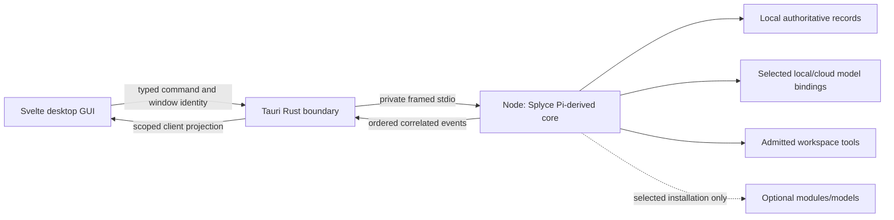

# Windows V1 desktop application contract

**Locked direction, reconciled 2026-10-26; runtime and Windows E2E evidence n=0.** V1 is a proper Windows desktop GUI. CLI/TUI is not a V1 user product. Pi SDK/RPC/headless paths are internal integration/diagnostic surfaces. The [stack decision](../foundations/desktop-stack-decision.md) locks Tauri 2, Svelte 5/strict TypeScript, Vite 8, a Rust shell and Node 24 LTS hosting the [Pi-derived fused core](core-fusion.md). Exact compatible patches/build hashes are frozen in TD-11, not inferred from moving guides.

## Execution and authority map

The renderer owns presentation and temporary interaction state. Rust owns window/native-dialog/IPC validation, packaged child identity and process lifetime. The Node engine owns model/session transitions, current grants, actions, receipts, verification and optional derived memory. Separately installed optional UI modules such as Monaco are served only through a read-only Rust-registered `splyce-module://<id>/<digest>/` scheme that TD-07 owns and that serves only directories TD-28 has verified; the base CSP allows that origin for scripts/workers, and a base-only install returns not-found for it. One shared versioned contract crosses the boundary; no renderer database, Rust model loop, generic command passthrough or second journal is introduced. TD-07 freezes a fixed Rust command set (`handshake`, `send(op, payload)`, `cancel`, event-channel subscribe, native dialog); `send` validates `op` and payload against the TD-01 operation allowlist, so a new operation is a TD-01 schema change rather than a Rust edit, and an unlisted operation is rejected in Rust with no engine effect. Credentials never enter renderer state, URLs, ordinary logs or exported profiles.

Use local compiled assets and explicit per-window Tauri capabilities/CSP. No remote page receives privileged IPC. Display provider/plugin/workspace/model text as data; previews cannot execute instructions or acquire grants. Do not expose arbitrary shell/filesystem/HTTP APIs directly to the webview. A user-selected cloud request is made by the qualified core adapter under its data policy, independently of frontend rendering.

## GUI workflow map

| Surface / task                              | Required visible behavior and failure states                                                                                                                                                         | Backend contract                                                                                              |
| ------------------------------------------- | ---------------------------------------------------------------------------------------------------------------------------------------------------------------------------------------------------- | ------------------------------------------------------------------------------------------------------------- |
| First launch/setup / TD-05/17/29            | Base-only and skip are defaults; selected Git-backed artifacts show exact dependencies, bytes/unknowns and install versus enable choices. No RAG/LSP/editor/model payload is preinstalled.           | I1 staged installation, profile configuration and no ambient loader activity.                                 |
| Workspace/task / TD-12/18/34                | Scoped workspace identity, task composer, streamed text/tool progress, interruption and final verified/unverified/uncertain states. Long content remains usable without losing authoritative events. | Current grant, run/action IDs, event cursor and snapshot-bound verification.                                  |
| Provider/profile/model / TD-30/33/35        | Multiple connections/profiles, independent role binding, requested/effective/ready distinction, next-turn versus cancel-and-switch. Auth/quota/load/unsupported states are distinct.                 | Versioned provider/profile/selection records and per-role egress; no implicit fallback.                       |
| Session list/tree/fork / TD-12/30/33        | Search/list without RAG, explicit ancestry/fork point, restore/resume, changed-workspace conflict and writer ownership. Fork does not pretend to clone files.                                        | Actual Pi entry ancestry, lease/epoch, workspace snapshot and reconciliation.                                 |
| Approval / TD-08/34                         | Target, arguments, data destination, grant scope and expiry visible; approve/deny/cancel stays correlated to the original request. Reconnect/changed args/revision makes stale approval inert.       | One-use request identity plus current engine policy at effect handoff, never renderer authority.              |
| Changes/evidence / TD-42/46                 | Plain text/diff and exact source/test receipts in the base. Optional Monaco is separately installed, with packaged workers/assets and no CDN. LSP/language services stay separate selections.        | Read/edit scope, source coordinates, snapshot/verification artifacts; no editor claim from file render alone. |
| Modules/plugins / TD-29/36/57               | Not-installed/off/starting/ready/draining/failed states, explicit trusted local/custom Git packages, update/rollback/remove with retained data and dependency owners.                                | I1/P1 install and lifecycle records; user-source files and external shared services survive removal.          |
| Memory/analysis/devices / TD-41/48/66/67/68 | Only installed features expose controls; citation/deletion/advisory/device-target states are truthful and independently disabled.                                                                    | Selected module gate, scope/epoch, actual provider/device and cleanup evidence.                               |
| Settings/support / TD-56/57/60              | Readable theme/keyboard/status/help, tested/unknown/unsupported distinction, local sanitized diagnostics/export controls. Viewing help executes nothing.                                             | Read-only typed projection; no secret/grant or support fabrication.                                           |

Every surface specifies initial, loading, empty, populated, validation-error, denied, unavailable, canceled, disconnected and recoverable-failure states where applicable. Keyboard focus order/restoration, accessible names, color-independent status, contrast, screen-reader behavior, text selection, window resize and high-DPI scaling belong to its acceptance criteria. UI/UX PRs carry automated UI evidence and, where applicable, a non-author `M` protocol run; MdSiddiqx (UI) and Itachi (backend/IPC) give optional review input.

The [frontend dossier](../frontend/README.md) refines composition, component/library choices, rendering and Windows acceptance. Codex is the workflow reference with complementary Claude patterns; Splyce owns original code/assets. TD-71–78 expand Dhanush/Shlok implementation under MdSiddiqx; the GUI consumes the same reviewed engine authority. TD-79 owns base session/artifact export/delete independently of optional memory.

Privileged Tauri application commands must be explicitly enrolled with `AppManifest::commands` and their capability permissions; registration with `invoke_handler` alone does not restrict them to a chosen bundled local window. TD-07 validates native caller/window/scope as well as argument schema. V1 ships exactly one privileged `main` webview; no other window label or capability target is configured. TD-50 and FUI-W9 require remote-origin and navigated content inside `main` to receive denial for every privileged custom command and shipped/enabled Tauri core/plugin IPC path outside its grants, with no effect, and a configuration check that no capability targets another label. This IPC qualification does not sandbox arbitrary trusted engine-plugin OS operations. [Official capabilities contract](https://tauri.app/security/capabilities/).

## Native process, stream and restart contract

1. Start one owned packaged engine child after validating actual binary/source/build identity. Handshake protocol/schema/fork/runtime revisions and readiness before accepting a task; unsupported versions fail without auto-download/repair.
2. Use framed validated messages with request/run/session IDs and durable sequence/cursor. Bound message sizes and pending queues, apply backpressure, and retain recoverable authoritative events outside transient UI buffers. A dropped progress display cannot discard an action/outcome.
3. Commands distinguish accepted, started, canceled, completed, failed and uncertain. Responses correlate once; out-of-order/duplicate/stale messages do not mutate another session or impersonate success. Model/tool arguments are complete and validated before native dispatch.
4. Client/window closure and engine cancellation are separate. Prompt for the explicit active-run disposition; closing a window does not silently replay/cancel effects. Shutdown fences new dispatch, drains/cancels owned work, records survivors and closes owned children/connections.
5. After hard kill/restart, reconcile store, process identity and uncertain effects before resume. A stale writer/approval/profile cannot acquire continuing authority. Missing model/package/credential is a visible blocked role, with original evidence retained.
6. Import, deep links, file-open requests and dropped files are untrusted input: validate scope and present the requested action; never auto-run code, install a package or submit a provider request from their presence.

These are proposed shared contracts, not existing Tauri command names. Use actual Tauri command/channel and Pi SDK APIs after the task's source check. Do not implement another general RPC framework or an unrestricted public localhost service for the desktop bridge.

### Native bootstrap and port readiness

The TD-07 bootstrap uses protocol version 2 while durable record schema version 1
remains unchanged. Rust resolves the application data directory and initializes
the owned child before exposing renderer commands. The engine opens its Store and
snapshot directory beneath that native location; renderer commands cannot select
a Store path. Bootstrap failure closes the owned child and reports a bounded error.

Core `readiness.state: ready` means the Store passed its structural audit and the
configuration, policy and receipt services loaded. It does not authorize generation.
The exact `readiness.ports` object reports boolean `generation`, `provider`,
`workspace` and `modules` availability. The renderer requires generation, provider
and workspace availability before reporting a usable generation connection, and
shows **Generation unconfigured** when the core is ready without those ports.
An `engine.status` event may carry the same strictly validated `ports` object;
subscribed clients update availability without reconnecting. Reconnection and
engine exit invalidate the previous availability and subscription generation.

At this bootstrap checkpoint the workspace registry is empty, no persisted grant
schema supplies authority, and all runnable ports remain unavailable. Profile and
configuration reads use the authoritative Store. The structural audit validates
local record shape, attribution and database integrity; it does not establish live
reference access or continuing grants. The full audit runs at bootstrap; later
authority reads validate scoped snapshots without rescanning historical events.
Profile selection follows the exact applied configuration transition, including
its pinned profile revision, rather than the latest written profile snapshot.
Real workspace admission, credential writes,
provider dispatch and port-flip production require their separate implementations
and qualification.

Existing stored protocol version 1 event envelopes are projected to version 2 in
memory before full validation and read/replay/export. Stored payload bytes,
sequence values, scope and deletion evidence remain unchanged. New writes and live
transport still require protocol version 2; unsupported stored versions fail closed.

## Windows acceptance and release

V1 release support is **Windows only**. TD-11 fixes advertised Windows version/architecture/runtime cells, the WebView2 Evergreen-or-fixed decision (under Evergreen a cell names a minimum version and each run records the tested version) and installer preparation; untested combinations are unsupported. Linux/macOS remain research/future ports, not required V1 deliverables. Count installer/download/unpacked bytes for the app, WebView provisioning, Node/Pi, native dependencies, optional artifacts and models separately; measure cold/warm startup, idle/peak memory/CPU and full-task quality. No fixed MB/RAM/speed superiority is claimed.

Required future cases: `D1_base_setup`, `D2_provider_profile_switch`, `D3_approval_revision`, `D4_session_resume_fork`, `D5_child_crash_reconnect`, `D6_optional_install_remove`, `D7_workspace_verify`, `D8_accessibility_dpi`, `D9_import_no_execution` and `D10_installed_upgrade_uninstall`. Each runs the actual packaged Tauri application with the real fused engine/store and physical fixture workspace. Include denied effects, interrupted installs/streams, failed persistence, lost outcomes and user-selected local/cloud paths. Fixtures must fail when the behavior is removed.

Use WebdriverIO with the qualified embedded Tauri service on an instrumented `e2e` build for U/P journeys, actual webview screenshots and native UIA accessibility checks. The uninstrumented release installer runs the release-smoke subset through external `tauri-driver` with an msedgedriver matching the tested WebView2 runtime. Browser/component tests and mocked IPC help diagnosis but cannot certify desktop E2E. Keep test-only automation permissions out of release builds and prove the release artifact preserves the tested runtime/authority behavior. Actual provider/device claims require separate authorized real-service evidence; deterministic transports establish fault behavior only. AGENTS forbids opening any PR with failed/unrun applicable E2E; documentation-only scope uses the existing documentation pipeline and explicitly records runtime E2E as N/A.

[Design index](README.md) · [Nine-person tasks](team-delivery-plan.md) · [Providers and sessions](providers-profiles-and-sessions.md)
